# MES-Springboot 制造执行系统

基于成熟开源 MES 系统二次开发的制造执行系统（MES），面向制造业生产管理场景，覆盖系统管理、工艺管理、计划管理、物料管理等核心业务，并在此基础上完成了用户注册、RBAC 权限管理、工艺管理、计划管理、AI 智能客服五大新增模块的开发。

## 在线演示

- 演示地址：http://www.meswozuiniu.icu:8887
- 默认账号：`admin` / `123`

## 技术架构

| 分类 | 技术选型 |
| --- | --- |
| 后端 | Spring Boot 2.1.7、MyBatis-Plus 3.1.2、Apache Shiro、Druid、Hutool |
| 前端 | FreeMarker、Layui、ECharts、jQuery |
| 数据存储 | MySQL 8.x、Redis / EhCache |
| 接口文档 | Swagger |
| 部署 | Jenkins + Docker + Nginx |

## 核心功能

| 模块 | 功能说明 |
| --- | --- |
| 系统管理 | 用户管理、组织（部门）管理、菜单管理、角色权限分配（RBAC）、操作日志 |
| 工艺管理 | 产品 BOM 管理、工艺路线管理、工序管理、工艺文件（SOP）、零部件管理 |
| 计划管理 | 工单下达、工序工单分解、工单流程变更、物料需求计划 |
| 物料管理 | 物料出入库、物料基础数据、物料标签管理 |
| 在制品管理 | 工序过站、在线维修 |
| 质量管理 | IQC / OQC / FQC、质检项维护 |
| 设备管理 | 设备档案、设备维修保养、设备稼动率 |
| 数据展示 | ECharts 图形化报表、数字化平台数据看板 |

## 新增功能（二次开发）

在原系统架构（Spring Boot + MyBatis-Plus + Shiro + FreeMarker/Layui）基础上新增五大核心业务模块。

### 1. 用户注册模块

提供自助注册入口，覆盖姓名、用户名、密码、部门、邮箱、手机号等必填信息校验与图形验证码防护；注册账号经管理员审核并分配初始角色后方可登录，形成"注册 → 审核 → 授权 → 登录"完整闭环。

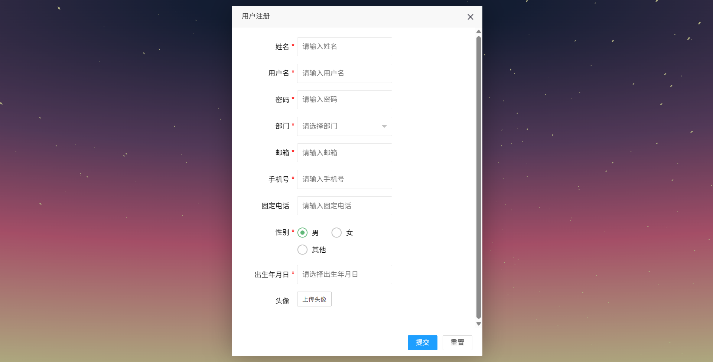

### 2. 角色权限管理（RBAC）

仅 admin 可操作的角色菜单授权矩阵（下图为权限管理界面，支持按角色一键授权菜单并实时统计授权状态）：

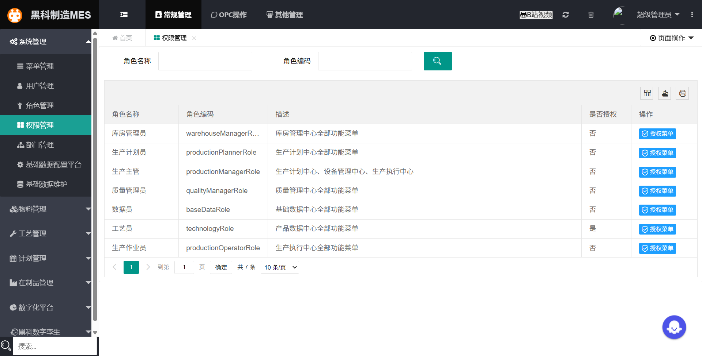

用户登录后，左侧导航栏根据当前账号的角色权限动态渲染，仅展示已授权的页面与功能入口，未授权菜单自动隐藏（下图为"工艺员"角色登录效果，仅可见工艺管理相关菜单）：

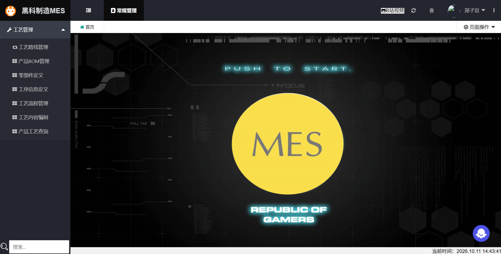

### 3. 工艺管理模块

覆盖产品工艺数据全生命周期的六大子功能：

- **产品 BOM 管理**：BOM 主表与明细联动维护，支持新增、编辑、删除、批量删除与物料编号检索；

  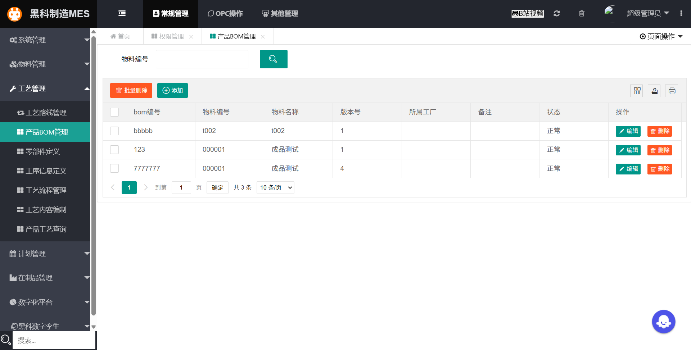

- **零部件定义**：零部件基础档案（编号、名称、备注、状态）维护，作为 BOM 与工艺数据的主数据底座；

  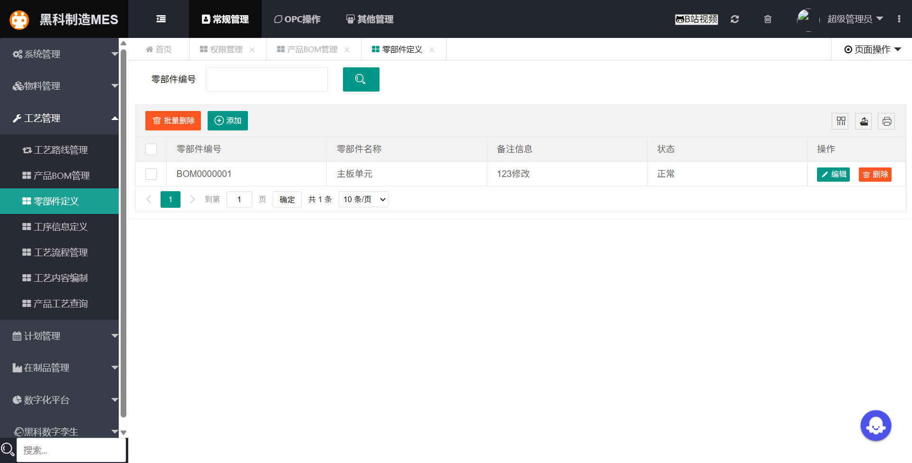

- **工序信息定义**：标准工序库维护（工序编号、名称、加工单元、工时、周期等），支撑工艺路线编排；

  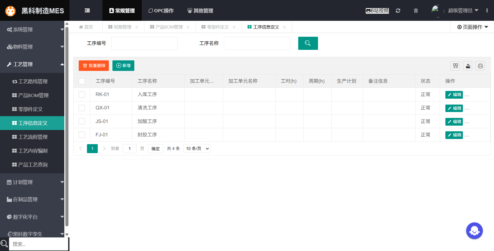

- **工艺流程管理**：选择产品后可初始化工艺关系、绑定产品工艺、新增工艺节点，按工序顺序完成工艺路线可视化编排；

  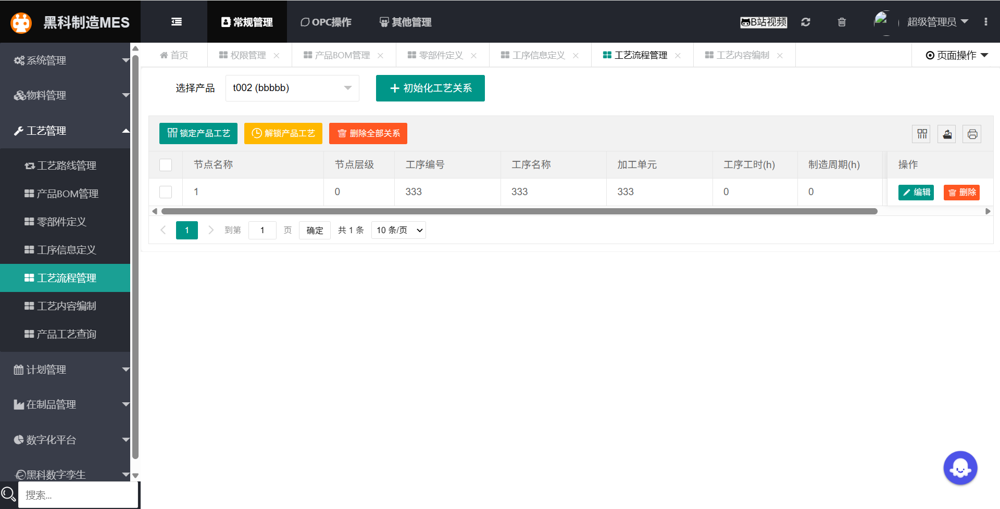

- **工艺内容编制**：按产品选择可编制的工艺节点，对工序内容进行结构化编制与管理；

  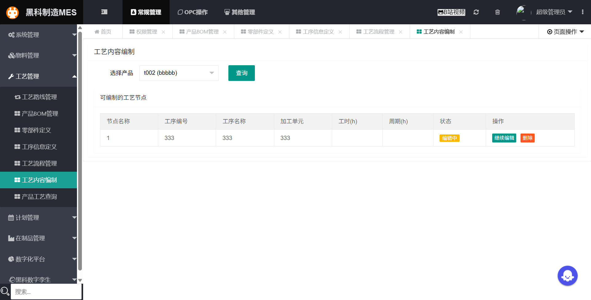

- **产品工艺查询**：选择产品后一站式呈现完整工艺结构，支持工序主信息、工序内容、工序要求、注意事项、工序设备、技术文档、备料清单等多维度信息查看。

  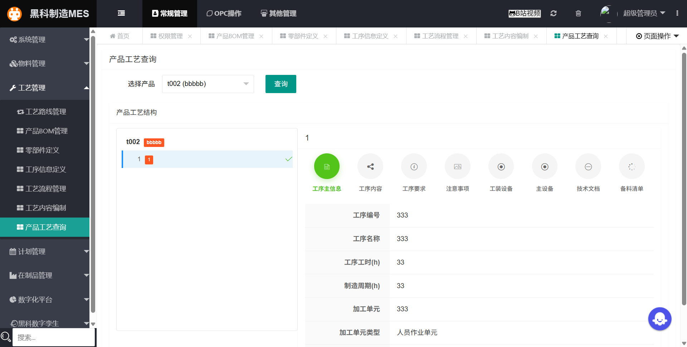

### 4. 计划管理模块

物料需求计划全流程管理：支持按所属订单编号、产品序列号、任务序列号、物料编号/名称、生成入库单状态、配送状态多条件组合查询；提供计划新增、编辑、批量删除；勾选记录可一键生成入库单，并支持按当前筛选条件导出标准化 Excel 报表。

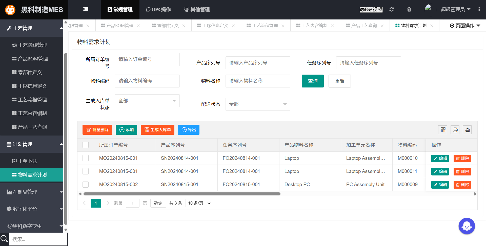

### 5. AI 智能客服模块

集成 Coze 大模型平台，页面右下角提供智能客服悬浮入口，支持多轮对话，为用户提供 MES 系统操作指引、业务问题答疑、功能使用教程等智能咨询服务（下图为客服助手"小智"解答零部件新增操作）：

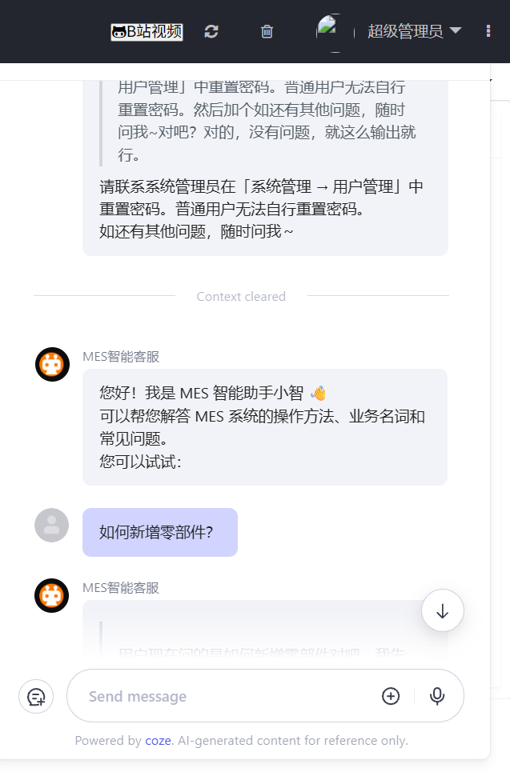

## 快速开始

### 环境要求

- JDK 1.8
- Maven 3.6+
- MySQL 8.x
- Redis（可选，系统默认缓存使用 EhCache）

### 安装步骤

1. **克隆项目**

   ```bash
   git clone <仓库地址>
   ```

2. **初始化数据库**

   创建数据库 `sparchetype`，导入完整备份脚本（含全部表结构与基础数据）：

   ```sql
   CREATE DATABASE sparchetype DEFAULT CHARACTER SET utf8mb4;
   ```

   ```bash
   mysql -uroot -p sparchetype < scripts/sql/backup_sparchetype_20260623_220530.sql
   ```

   也可先导入原始基础库 `scripts/sql/MySQL-20210225.sql`，再按需执行其余增量脚本。

3. **修改配置**

   编辑 `mes/src/main/resources/application-pro.yml`，按本地环境调整数据库连接（默认 `localhost:3306/sparchetype`）及 AI 客服（Coze）配置。

4. **启动服务**

   运行主类 `com.wangziyang.mes.SparchetypeApplication`，或在 `mes` 目录执行：

   ```bash
   mvn spring-boot:run
   ```

5. **访问系统**

   浏览器打开 `http://localhost:8080`，使用默认账号 `admin` / `123` 登录。

### 基础使用

- **登录与导航**：登录后左侧导航栏按当前账号角色动态展示可访问菜单；
- **权限配置**：系统管理 → 权限管理，为角色勾选可访问菜单并保存；
- **工艺数据维护**：先维护零部件与工序基础数据，再编排 BOM 与工艺路线；
- **计划管理**：计划管理 → 物料需求计划，维护计划后勾选记录一键生成入库单，支持按筛选条件导出 Excel；
- **AI 客服**：页面内智能客服入口，可随时咨询系统操作与业务问题。

## 开发文档

- 前端工具库：`dayjs`、`lodash`、Layui 树形表格、FontAwesome、ECharts
- Ajax 请求示例：[docs/ajax.md](./docs/ajax.md)
- FreeMarker 使用说明：[docs/FreeMarker.md](./docs/FreeMarker.md)
- Layui 自定义组件：[docs/spLayer.md](./docs/spLayer.md)、[docs/spTable.md](./docs/spTable.md)
- 下拉框初始化：[docs/layuiSelect.md](./docs/layuiSelect.md)
- 后端规范：一张表对应一个分页请求参数对象（如 `SysUserPageReq`）；公共枚举类 `CommonEnum`
- Swagger 接口文档：启动后访问 `http://localhost:8080/swagger-ui.html`

## 鸣谢

本项目基于开源项目 [MES-智能制造/MES-Springboot](https://gitee.com/wangziyangyang/MES-Springboot) 进行二次开发，感谢原作者的开源贡献。
