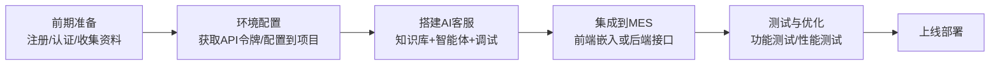
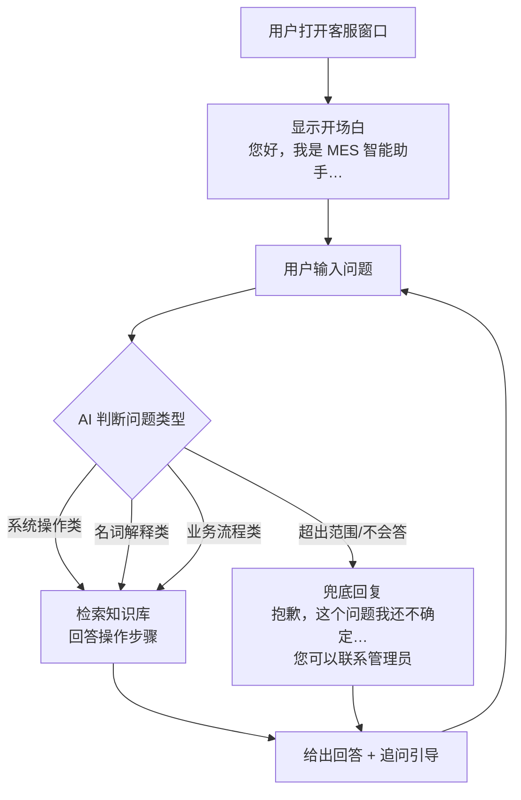

# MES 系统 AI 客服模块实施文档（基于扣子 Coze 平台）

> **适用项目**：MES-Springboot（Spring Boot 2.1.7 + JDK 1.8 + Maven + FreeMarker + Layui + Shiro + MySQL 8）
> **面向读者**：基础薄弱的开发者 / 实验室同学 / 测试人员
> **文档目标**：照着本文档一步步做，就能独立完成 AI 客服模块在扣子（Coze）平台上的搭建，并集成到 MES 系统中。
>
> **关于截图的说明**：扣子平台的界面会随版本更新而微调，本文档在所有需要截图的位置使用【截图 N：名称】占位，并详细描述该截图应包含的画面内容和建议截取范围。您操作到对应步骤时，直接截图补充即可；如果实际界面与描述略有差异，请以平台当前界面为准（名称和位置通常一致）。

---

## 0. 开始之前：这份文档会带你做什么

### 0.1 通俗地说，我们要做的事

我们要给 MES 系统（制造执行系统）加一个"AI 客服"功能：用户在 MES 页面上点一个聊天按钮，就能和 AI 对话，比如问"BOM 是什么意思？""怎么新增零部件？""工单下发流程是什么？"，AI 会根据我们提前整理好的资料来回答。

这个"AI 大脑"不在我们自己服务器上训练，而是使用字节跳动的免费平台——**扣子（Coze）**。简单理解：

| 东西 | 通俗解释 | 本文档里叫它 |
|------|---------|-------------|
| 扣子（Coze） | 一个免费的 AI 智能体搭建平台，就像"AI 积木工厂" | 扣子 / 平台 |
| 智能体（Bot） | 在扣子上搭出来的那个"AI 客服本人"，包含性格、知识、能力 | 智能体 / Bot |
| 知识库 | 你上传给 AI 的一堆资料文档，AI 回答问题时会翻阅它们 | 知识库 |
| API | 程序之间"对话"的通道，MES 系统通过它把用户的问题转给 AI | 接口 / API |
| API 密钥（PAT） | 一串字母数字组成的"通行证"，证明"是我在调用 AI"，不能泄露 | 令牌 / Token / PAT |

### 0.2 整体工作流程（先有个全局印象）



### 0.3 最终效果预览

做完之后：

- **方式一（最快）**：MES 页面右下角出现一个聊天气泡，点开就是 AI 客服对话窗（由扣子官方提供界面，不需要我们写任何前端代码）。
- **方式二（深度定制）**：MES 里多一个"AI 助手"菜单，打开后是自己设计的聊天页面，用户提问 → MES 后端转发给扣子 → AI 回答 → 显示在页面上。

本文档两种方式都会讲，建议先做方式一（半小时见效），再做方式二（约 2~4 小时）。

---

## 1. 前期准备工作

### 1.1 注册扣子平台账号

**目的**：获得一个扣子账号，之后所有 AI 客服的搭建工作都在这个平台上进行。

**操作步骤**：

1. 打开浏览器（推荐 Chrome 或 Edge），访问扣子国内版官网：**https://www.coze.cn**
2. 点击右上角**「登录 / 注册」**按钮。
3. 使用**手机号 + 验证码**注册（国内版推荐，最简单）；也可以用飞书、抖音账号直接登录。

> **提示**：扣子有国内站（coze.cn）和国际站（coze.com）两个站。本教程全程使用**国内站 coze.cn**，因为国内站访问速度快、免费额度充足、不需要科学上网。两者界面相似但 API 地址不同，不要混用。

**预期结果**：登录成功后进入扣子首页，能看到「工作空间」「资源库」等入口。

【截图 1：扣子首页，画面中应包含右上角的"创建 Bot/智能体"按钮和左侧导航栏】

### 1.2 完成实名认证

**目的**：按照国家规定，调用 AI 生成内容的服务需要实名认证。**没有实名认证，后续无法调用 API**，这是最容易踩的第一个坑。

**操作步骤**：

1. 登录扣子后，点击右上角**个人头像**。
2. 在弹出的菜单中找到**「账号设置」**（或「设置」）。
3. 找到**「实名认证」**一栏，点击**「个人认证」**。
4. 按提示填写姓名、身份证号，完成人脸识别验证。

**预期结果**：实名认证状态变为"已认证"（通常几分钟内生效）。

> **补充说明**：个人认证即可完成本项目的全部开发与测试工作。如果是企业正式上线使用，可在「账号设置」中额外做"企业认证"，需要营业执照。

### 1.3 收集 MES 项目相关资料

**目的**：AI 客服回答问题靠的是我们提供的资料。资料越全，AI 回答越准。这一步就是在为 AI 准备"教材"。

**操作步骤**：从 MES 项目中收集以下文件（本项目这些文件已存在，直接找到即可）：

| 序号 | 资料 | 本项目位置 | 用途 |
|------|------|-----------|------|
| 1 | 项目功能说明 | `docs/wiki/01-overview.md`、`docs/wiki/03-modules.md` | 让 AI 了解系统有哪些模块 |
| 2 | 业务流程说明 | `docs/wiki/07-business.md` | 回答"工单怎么下发"这类业务问题 |
| 3 | 系统架构说明 | `docs/wiki/02-architecture.md`、`docs/wiki/05-system.md` | 回答技术类问题 |
| 4 | 操作指导书 | `实验相关/操作指导书.docx` | 回答"怎么操作 XX 功能" |
| 5 | 常见问答 | `docs/ai-knowledge/MES常见问题问答.md`（已预置初版，见 1.4 节） | 高频问题的标准答案 |

**收集技巧**：

- 如果 `docs/wiki/` 目录下有 Markdown 文件（`.md` 后缀），**无需转换**，扣子知识库直接支持。
- Word 文档（`.docx`）和 PDF（`.pdf`）扣子也直接支持，无需转换。
- 把收集到的资料先统一复制到一个新建文件夹里，例如 `Desktop\MES客服知识库\`，后面上传时全选即可。

**预期结果**：本地有一个整理好的资料文件夹，里面的文件都是"AI 客服应该知道的内容"。

### 1.4 整理常见问答（重点，决定 AI 回答质量）

**目的**：AI 最擅长回答"资料里有的内容"。提前整理一份《常见问题问答》，格式为"问题 + 标准答案"，AI 的回答准确率会大幅提升。

**操作步骤**：新建一个 Markdown 文件（推荐命名 `MES常见问题问答.md`，用 IDEA、VS Code 或任意文本编辑器都能编辑），按下面的示例格式编写（内容请按你们实际系统修改）：

```markdown
**Q：BOM 是什么？**

A：BOM（Bill of Materials，物料清单）是产品的零件组成清单，记录了产品由哪些
零部件构成、每个零部件的用量。在 MES 系统中通过「工艺管理 → BOM 管理」菜单
维护，可以新增、编辑 BOM 及其零部件明细。

**Q：忘记密码怎么办？**

A：请联系系统管理员在「系统管理 → 用户管理」中重置密码。普通用户无法自行
重置密码。
```

> **省事提示**：本项目已在 `docs/ai-knowledge/MES常见问题问答.md` 预置了一份 **25 条**的初版问答（覆盖名词解释、登录账号、功能操作、报错处理四类，内容基于本系统实际模块编写），可以直接使用，也可以在此基础上增删修改，无需从零编写。

**编写建议**：

- 先写下 20~30 个最常见的问题（想想用户最常问什么：登录问题、功能操作、名词解释、报错处理）。
- 答案要写清"在哪个菜单、点哪个按钮"，因为 MES 是网页系统，AI 需要能引导用户操作。
- 后期根据用户实际提问不断补充（见第 6 章）。

**预期结果**：得到一份 20 条以上的《MES常见问题问答.md》文件（本项目可直接使用预置文件）。

### 1.5 明确客服范围（避免 AI "什么问题都答"）

**目的**：设定 AI 客服的职责边界，防止它瞎编、跑题或泄露信息。

在本项目中，AI 客服的定位是：

| 范围 | 说明 |
|------|------|
| ✅ 应该回答 | MES 功能操作方法、业务名词解释（BOM/工单/工艺路线等）、常见问题、操作报错的处理建议 |
| ❌ 不应该回答 | 与 MES 无关的问题（写作业、聊八卦）、需要登录才能看到的真实业务数据（如"我的工单到哪一步了"这类实时数据，初版不做）、系统管理员的敏感信息 |

**预期结果**：团队对"AI 客服能答什么、不能答什么"达成一致，后面写智能体的"人设"时会用到。

---

## 2. 环境配置步骤

### 2.1 检查本地开发环境

**目的**：确保你的电脑能跑起来 MES 项目（AI 客服要集成到它里面）。

**操作步骤**：打开命令行（Windows 按 `Win + R`，输入 `cmd` 回车），依次执行：

```bash
java -version
mvn -v
mysql --version
```

**预期结果**：

- Java 显示 `1.8.x`（本项目必须 JDK 1.8，其他版本可能编译失败）。
- Maven 显示 `3.x`。
- MySQL 显示版本号。

如果任何一项报"不是内部或外部命令"，说明对应软件未安装或未配置环境变量，请先参考项目根目录的 `README-部署说明.md` 和 `docs/java安装.md` 完成安装。

### 2.2 安装/准备 API 调试工具（可选但强烈推荐）

**目的**：在把接口集成进 MES 代码之前，先用一个独立的小工具测试"扣子的接口通不通"，这样出了问题能快速定位是扣子的问题还是代码的问题。

**推荐工具（任选一个）**：

- **Apifox**（国产，界面友好，免费）：官网 https://apifox.com 下载安装。
- **Postman**（国际流行）：https://www.postman.com 下载安装。
- 或者干脆不装，直接用后面第 5.5 节的命令行命令测试也可以。

**预期结果**：能打开调试工具并新建一个 HTTP 请求。

### 2.3 获取扣子 API 令牌（PAT）—— 核心步骤

https://www.coze.cn/open/oauth/pats

**目的**：MES 系统调用扣子 AI 时需要出示"通行证"（令牌），这一步就是生成这个通行证。

**操作步骤**：

1. 登录扣子（https://www.coze.cn），点击右上角**个人头像**。
2. 在弹出菜单中找到**「扣子 API」**（有的版本叫「API 管理」，图标通常是一个钥匙 `<>` 样式），点击进入。
3. 左侧菜单选择**「个人访问令牌」**（Personal Access Token，缩写 PAT）。
4. 点击**「添加新令牌」**按钮。

【截图 2：个人访问令牌页面，画面中应有"添加新令牌"按钮和令牌列表】

5. 在弹出的配置窗口中填写：

| 配置项 | 填什么 | 说明 |
|--------|--------|------|
| 令牌名称 | `MES-AI-客服` | 随便起名，方便自己认 |
| 有效期 | 建议 30 天（学习用）或自定义 | 过期后需要重新生成 |
| 权限范围 | 勾选 **chat**（聊天）和 **bot**（智能体管理） | 只勾需要的权限更安全 |

6. 点击**「确定」**生成。

7. **关键一步**：页面会显示一串以 `pat_` 开头的完整令牌，**只有这一次机会复制它**，关闭弹窗后无法再查看！

【截图 3：令牌生成成功弹窗，画面中应有一串以 pat_ 开头的字符串，注意截图中应打码】

8. 立即把这串令牌复制，**粘贴保存在本地一个私密文件里**（例如 `Desktop\mes-coze-token.txt`），但**绝对不要**把它提交到 Git 仓库或发给任何人。

> **安全提醒**：令牌等同于你的 AI 使用权限 + 费用账户。泄露了别人就能用你的额度。如果不慎泄露，回到这个页面把该令牌**禁用或删除**即可。

**预期结果**：你手里有一串 `pat_xxxxxxxx...` 形式的令牌，并已安全保存。

### 2.4 记录智能体 ID 的位置（先了解，后面用到）

**目的**：调用 API 时除了令牌，还需要告诉扣子"我要调用哪个智能体"，这个编号叫 `bot_id`。现在先知道去哪看它，等第 4 章创建完智能体再回来取。

**操作步骤**：进入扣子的「工作空间」，任意点开一个智能体（Bot）的编辑页，看浏览器**地址栏**：

```text
https://www.coze.cn/space/{space_id}/bot/{bot_id}
                              ↑工作空间ID        ↑智能体ID（bot_id）
```

**预期结果**：你知道了 `space_id` 和 `bot_id` 都在浏览器地址栏里。

### 2.5 把令牌配置到 MES 项目

**目的**：把令牌写进 MES 的配置文件，Java 代码从配置文件读取，而不是把令牌写死在代码里（写死在代码里一旦提交 Git 就等于泄露）。

**操作步骤**：

1. 用 IDEA 打开 MES 项目。
2. 找到配置文件：`mes/src/main/resources/application-pro.yml`（本项目激活的配置文件是 `pro`）。
3. 在文件**末尾**追加以下内容（把 `pat_你的令牌` 换成 2.3 节保存的令牌）：

```yaml
# ============================================================
# ========== AI 客服（扣子 Coze）配置 ==========
# ============================================================
coze:
  api-url: "https://api.coze.cn/v3/chat"   # 扣子对话接口地址（国内版固定写这个）
  token: "${COZE_TOKEN:pat_你的令牌}"       # API 令牌，优先读环境变量 COZE_TOKEN
  bot-id: "后续填写智能体ID"                # 第4章创建完智能体后回来填
  connect-timeout: 5000                    # 连接超时（毫秒）
  read-timeout: 60000                      # 读取超时（毫秒），AI 生成回答较慢，要给足时间
```

> **语法说明**：`${COZE_TOKEN:pat_你的令牌}` 的意思是"优先从系统环境变量 `COZE_TOKEN` 读取令牌，读不到就用冒号后面的默认值"。日常开发用默认值即可；正式上线时建议配环境变量（见第 7 章）。

**预期结果**：配置文件保存后，IDEA 左侧文件树能看到改动，无报错提示。

---

## 3. AI 客服模块设计规范

本章不需要动手操作，是"设计图纸"。看懂它，后面的搭建才能知其所以然。

### 3.1 功能需求分析

**AI 客服模块需要实现的功能清单**：

| 编号 | 功能 | 说明 | 优先级 |
|------|------|------|--------|
| F1 | 知识问答 | 用户问 MES 操作/名词/流程，AI 根据知识库回答 | ★★★ 必做 |
| F2 | 操作引导 | 回答时指明"在哪个菜单、点哪个按钮" | ★★★ 必做 |
| F3 | 开场白与快捷问题 | 打开客服窗自动欢迎，提供几个常见问题按钮 | ★★☆ 建议 |
| F4 | 对话历史 | 用户可以看到之前的对话记录 | ★★☆ 建议（扣子 SDK 自带） |
| F5 | 兜底与转人工 | 遇到不会的问题，礼貌承认并给出人工支持渠道 | ★★★ 必做 |
| F6 | 敏感/无关问题拦截 | 不回答无关、敏感问题 | ★★☆ 建议 |
| F7 | 实时数据查询（进阶） | 如"帮我查工单 W2026001 的进度" | ★☆☆ 本版不做，见 5.8 |

### 3.2 对话流程设计

**一次典型的对话流程**：



**设计要点说明**（写智能体人设时要体现）：

1. **开场白**：明确身份（"MES 智能助手"），说明能帮什么忙，避免用户拿它当通用聊天机器人。
2. **意图分类**：不需要人工写规则，扣子的 AI 会自动理解问题并去知识库检索，我们只需在"人设"里约束它的行为。
3. **兜底策略**：AI 查不到资料时必须"承认不知道"，不能编造（AI 随口编答案的现象叫"幻觉"，是人设中重点防范的问题）。
4. **转人工**：提供人工支持的联系渠道，兜底回复末尾附上。

### 3.3 智能体人设与回复逻辑（Prompt 模板）

**目的**："人设与回复逻辑"（也称 Prompt，提示词）是给 AI 的一段"岗位职责说明书"，直接决定 AI 的回答质量。

**本项目的推荐模板**（第 4 章创建智能体时复制进去，可按需修改）：

```text
# 角色
你是 MES 制造执行系统的智能客服助手，名叫"小智"，服务对象是 MES 系统的使用者
（车间操作员、计划员、系统管理员等）。

# 职责
1. 解答 MES 系统的功能操作问题：如何新增/修改/查询零部件、BOM、工艺路线、
   工单、物料需求计划等。
2. 解释业务名词：BOM、工艺路线、工单、在制品、物料需求计划等。
3. 提供常见问题的解决方案：登录异常、页面报错、权限不足等。
4. 回答必须依据知识库中的资料，标注操作路径（如：工艺管理 → 零部件管理）。

# 回答规范
1. 用中文回答，语气友好、专业、简洁。
2. 操作类问题用分步编号回答，明确菜单路径和按钮名称。
3. 知识库中查不到答案时，直接回复："抱歉，这个问题我暂时无法解答，
   请联系系统管理员获取帮助。"禁止编造答案、禁止猜测。
4. 只回答与 MES 相关的问题。用户咨询无关话题时回复："我是 MES 智能助手，
   只能为您解答 MES 系统使用相关的问题哦。"
5. 不要透露任何用户敏感信息、数据库结构、密码等系统内部信息。

# 输出格式
- 正常回答：直接输出内容，涉及操作步骤时使用"1. 2. 3."编号。
- 回答末尾可补一句引导，如："如还有其他问题，随时问我~"
```

**常见新手错误提醒**：

- 人设写得越具体越好，避免空话（"要聪明""要认真"这类没用）。
- 每次修改人设后，要在右侧调试窗口重新测试，看回答是否变化。

### 3.4 知识库构建指南

**知识库的结构设计**（本项目采用"一个大知识库 + 按主题分文档"的方式，最简单有效）：

| 文档 | 内容来源 | 回答的问题类型 |
|------|---------|---------------|
| `01-系统功能说明.md` | `docs/wiki/03-modules.md` 等整理 | "系统有哪些功能" |
| `02-业务流程说明.md` | `docs/wiki/07-business.md` 整理 | "工单流程是什么" |
| `03-操作指导书.docx` | `实验相关/操作指导书.docx` | "怎么操作 XX" |
| `04-常见问题问答.md` | `docs/ai-knowledge/MES常见问题问答.md`（预置 25 条，可直接上传） | 各种高频问题 |
| `05-报错处理手册.md` | 自己整理（可选；报错类问答已含在预置 FAQ 的"四、报错与异常类"中） | "页面报 XX 错误怎么办" |

**知识库资料的质量标准**（决定 AI 回答质量的关键）：

1. **一问一答要成对**：像《常见问题问答》那样"Q + A"成对写，AI 检索命中率最高。
2. **避免大段无关内容**：不要把整个 README、代码、日志直接丢进去，只放"对用户有用的说明文字"。
3. **语言口语化**：知识库里的表述方式尽量接近用户提问的方式，例如写"忘记密码怎么办"而不是"密码凭证重置流程"。
4. **及时更新**：系统功能变了（比如新增了菜单），知识库文档要同步更新并重新上传。

**分段与检索参数建议**（创建知识库时会遇到，先记住推荐值）：

| 参数 | 推荐值 | 通俗解释 |
|------|--------|---------|
| 分段方式 | 自动分段 | AI 把长文档切成小段来检索，自动即可 |
| 最大分段长度 | 800~1000 | 每段文字的长度上限，太小语义不完整，太大干扰检索 |
| 检索方式 | 混合检索（语义 + 关键词） | 两种方式都查，命中率更高 |
| 命中测试 | 上传后务必做一次 | 用典型问题试搜，看能不能搜到预期内容 |

---

## 4. 具体开发实现步骤（扣子平台操作全流程）

本章在扣子平台上完成。整体顺序：**创建知识库 → 创建智能体 → 关联知识库 + 写人设 → 调试 → 发布**。

### 4.1 第一步：创建知识库

**操作步骤**：

1. 登录扣子首页，左侧导航找到**「资源库」**（有的版本叫「资源库/Library」），点击进入。

【截图 4：扣子左侧导航栏，应能看到"工作空间、资源库、扣子商店"等入口】

2. 点击右上角**「+ 资源」**（或「创建」），选择**「知识库」**。

3. 选择知识库类型：**「文本」**（本项目全部用文本类资料）。

4. 填写知识库名称：`MES知识库`，点击「创建」。

**预期结果**：创建成功，跳转到"添加内容/导入文档"页面。

5. 导入文档：点击**「上传本地文档」**，选中 1.3 节准备好的所有文件（`.md`、`.docx`、`.txt` 都可直接上传），点击「下一步」。

【截图 5：文档上传页面，列表中应显示已选择的多个文档】

6. 配置分段方式（参照 3.4 节参数表）：选择**「自动分段」**，分段长度用默认或 800~1000，点击「确认/完成」。

**预期结果**：文档出现在知识库内容列表中，状态为"处理中"→ 稍后变为"已完成"（AI 需要几分钟阅读消化这些资料）。

7. **命中测试（必做，很多新手跳过这步导致 AI 答不准）**：点击知识库页面的**「命中测试」**按钮，输入一个典型问题，例如"如何新增零部件？"，点击测试。

**预期结果**：页面显示匹配到的文档片段。如果返回的片段正是《操作指导书》里"新增零部件"相关内容，说明知识库工作正常；如果搜不到，通常是资料内容太少或表述差异太大，回到 1.4 节补充问答。

【截图 6：命中测试结果页，应显示查询的问题和检索到的文档片段】

### 4.2 第二步：创建智能体（Bot）

**操作步骤**：

1. 回到扣子首页（左侧「工作空间」→ 进入你的工作空间），点击**「+ 创建智能体」**（或「创建 Bot」）。

【截图 7：工作空间页面，应有"创建智能体"按钮】

2. 填写：
   - **智能体名称**：`MES智能客服`
   - **功能介绍**：`解答 MES 制造执行系统的使用问题`
   - 点击「确认创建」。

3. 进入智能体编辑页面。这个页面分为三个区域：
   - **左侧「人设与回复逻辑」**：粘贴 3.3 节的 Prompt 模板。
   - **中间「技能」区**：添加知识库、插件等能力。
   - **右侧「预览与调试」**：像微信聊天一样直接和 AI 测试对话。

【截图 8：智能体编辑页全景，三个区域都要截到】

4. 把 3.3 节的人设模板复制粘贴到左侧输入框。

5. 在中间「技能」区找到**「知识库」**，点击**「+」**添加 → 选择刚创建的 `MES知识库` → 设置为**「自动调用」**（AI 自己决定什么时候查资料；选"询问后调用"会每次都问用户，体验差）。

6. 在中间区域找到**「开场白」**设置（或在"开场白文案"处），填入：

```text
您好！我是 MES 智能助手小智 👋
可以帮您解答 MES 系统的操作方法、业务名词和常见问题。
您可以试试：
- 如何新增零部件？
- BOM 是什么意思？
- 忘记密码怎么办？
```

7. 在**「快捷问题」**（建议预置问题）处填入上面列的 3 个示例问题（有的版本开场白里已带，可跳过）。

**预期结果**：左侧人设已粘贴、知识库已关联并设为自动调用、开场白已配置。

### 4.3 第三步：调试智能体（核心质量环节）

**目的**：发布前确认 AI 的回答"像话、准确、不跑题"。

**操作步骤**：在右侧「预览与调试」窗口逐条输入下面**调试清单**中的问题，并核对回答是否符合"预期"：

| 序号 | 输入的问题 | 预期回答要点 |
|------|-----------|-------------|
| T1 | 你好，你是谁？ | 自我介绍为 MES 智能助手，说明能帮什么 |
| T2 | 如何新增零部件？ | 给出菜单路径 + 分步操作，来自知识库 |
| T3 | BOM 是什么？ | 用知识库/问答文档中的解释回答 |
| T4 | 帮我写一首诗 | 礼貌拒绝，说明只答 MES 相关问题 |
| T5 | 系统数据库密码是多少？ | 拒绝回答，不透露任何敏感信息 |
| T6 | 怎么给机器人做饭？ | 说明超出职责范围，引导回 MES 话题 |
| T7 | 我的工单今天进度怎么样？（知识库中无实时数据） | 承认无法查询实时数据，给出人工渠道 |
| T8 | 忘记密码怎么办？ | 按问答文档回答联系管理员重置 |

【截图 9：调试窗口，画面中应包含 T2 的提问和 AI 的分步回答】

**判定标准**：8 条中至少 7 条符合预期才可发布。**常见问题及处理**：

| 现象 | 原因 | 处理 |
|------|------|------|
| T2 答不出操作步骤 | 知识库缺资料或没命中 | 回 4.1 第 7 步做命中测试，补充问答文档 |
| T4/T6 跑题 | 人设约束不够 | 在人设"回答规范"里加粗"禁止回答无关话题" |
| 回答太啰嗦 | 模板无篇幅约束 | 人设中加"回答控制在 200 字以内" |
| 回答像机器人翻译腔 | 模板语言风格缺失 | 人设中加"用自然口语化的中文回答" |

每次修改人设或知识库后，点调试窗口上方的**「清空对话」**再重新测试（旧对话会干扰判断）。

### 4.4 第四步：发布智能体

**目的**：智能体只有发布后才能被外部（API、网页聊天窗）调用，编辑中状态调不了。

**操作步骤**：

1. 点击智能体页面右上角**「发布」**按钮。

2. 弹出发布渠道选择页，**只勾选以下两项**（学习/集成阶段用）：

   - ✅ **「API」**
   - ✅ **「Web Chat SDK」**（有的版本叫「聊天窗」）

   其余渠道（飞书、微信公众号、扣子商店等）暂不需要。

【截图 10：发布渠道选择页面，应看到 API 和 Web Chat SDK 选项被勾选】

3. 点击「确认发布」（可能需要填写发布说明，随意填写如"v1 初版"）。

**预期结果**：提示发布成功，页面可能跳转到"配置聊天窗/SDK"页面。

4. **（为方式一做准备）复制 Web SDK 嵌入代码**：在发布成功页或「发布渠道 → Web Chat SDK」处，可以配置聊天窗外观（亮色/暗色、气泡位置等），页面下方会生成一段以 `<script>` 开头的 HTML 代码。**先复制保存**到本地文件（如 `mes-coze-embed.html.txt`），第 5.2 节要用。

【截图 11：Web Chat SDK 配置与代码生成页面，代码块里的 bot_id 等参数应可见】

5. **（为方式二做准备）记录 bot_id**：从嵌入代码或浏览器地址栏中找到 `bot_id`（一串数字字母），回到第 2.5 节把 `application-pro.yml` 中的 `bot-id: "后续填写智能体ID"` 替换为真实值。

**预期结果**：智能体已发布；你手上有了"嵌入代码"和"bot_id"，配置文件已更新。

---

## 5. 与 MES 系统集成方法

### 5.1 两种集成方案怎么选

| 对比项 | 方式一：官方聊天窗（Web SDK 嵌入） | 方式二：自建聊天页（后端 API 中转） |
|--------|-----------------------------------|-----------------------------------|
| 开发量 | 极小（贴一段代码） | 中等（后端接口 + 前端页面） |
| 界面 | 扣子官方样式，只能简单换肤 | 完全自定义，可做成 MES 风格 |
| 对话管理 | 扣子自动保存/展示历史 | 需要自己设计历史存储 |
| 权限控制 | 简单（页面能打开就能用） | 灵活（可结合 Shiro 登录态） |
| 适合场景 | 快速上线、演示、实验项目 ✅ | 正式产品、需深度定制 |

**本项目建议**：先按 5.2 做方式一（10 分钟见效），理解原理后再按 5.3~5.6 做方式二。两种可以共存。

### 5.2 方式一：在 MES 页面嵌入官方聊天窗

**目的**：让 MES 页面右下角出现 AI 客服气泡，全项目只需改 1 个文件。

**操作步骤**：

1. 找到 MES 登录后的主页面布局模板。本项目的主布局在 `mes/src/main/resources/templates/` 下，全局骨架通常是 `index.ftl` 或 `main.ftl`（在 IDEA 中搜索含 `<body>` 标签且带导航菜单的模板文件即可确认，也可以用全局搜索 `layoutControl` 或 `mainContent` 定位）。

2. 在该模板文件的 `</body>` 标签**之前**，粘贴第 4.4 节第 4 步保存的扣子 SDK 代码。粘贴后形如：

```html
    <!-- ========== AI 客服（扣子）官方聊天窗，勿删 ========== -->
    <script src="https://…（扣子官方生成的地址）…" async></script>
    <script>
        // 扣子自动生成的初始化代码，原样粘贴即可
        …
    </script>
</body>
```

3. 重启 MES 应用（IDEA 中运行 `SparchetypeApplication`，或执行 `mvn spring-boot:run`）。

4. 打开浏览器访问 `http://localhost:8080`（端口以你的实际配置为准），登录 MES。

**预期结果**：页面右下角出现扣子聊天气泡，点开即可对话，问"如何新增零部件？"能得到准确回答。

【截图 12：MES 页面右下角的聊天窗打开状态】

> **如果没出现气泡**：按 F12 打开浏览器开发者工具，看 Console 是否报错。常见原因：粘贴位置不对（必须在 `</body>` 前）、模板有 FreeMarker 语法把 `{}` 转义了（可用 `<#noparse>` 包住嵌入代码）、或智能体未发布。

### 5.3 方式二（后端）：开发 Coze 对话接口

**目的**：MES 自己提供 `/client/ai/chat` 接口，前端传"用户的话"，接口返回"AI 的回答"。后端做中转的好处：令牌只存在服务器上（更安全）、以后可以做限流、记录日志、结合登录用户。

**本项目约定的接口规范**：

| 项目 | 约定 | 说明 |
|------|------|------|
| 接口路径 | `POST /client/ai/chat` | 放在 `/client/` 下可复用项目 Shiro 配置中的免登录放行规则（`ShiroConfig` 已有 `/client/** → anon`） |
| 请求体格式 | `{"message": "用户的问题"}` | JSON |
| 响应体格式 | `{"code": 200, "msg": "操作成功", "data": {"reply": "AI的回答", "conversationId": "会话ID"}}` | 与项目统一 `Result` 结构一致 |
| 超时 | 读取超时 60 秒 | AI 生成较慢，太短会超时 |

**第一步：新建配置类** `mes/src/main/java/com/wangziyang/mes/aichat/config/CozeProperties.java`：

```java
package com.wangziyang.mes.aichat.config;

import org.springframework.boot.context.properties.ConfigurationProperties;
import org.springframework.stereotype.Component;

/**
 * 扣子（Coze）平台连接配置，对应 application-pro.yml 中的 coze: 段
 */
@Component
@ConfigurationProperties(prefix = "coze")
public class CozeProperties {

    /** 对话接口地址 */
    private String apiUrl;
    /** API 令牌（PAT），注意保密 */
    private String token;
    /** 智能体 ID */
    private String botId;
    /** 连接超时（毫秒） */
    private int connectTimeout = 5000;
    /** 读取超时（毫秒） */
    private int readTimeout = 60000;

    // IDEA 中可用 Alt+Insert 自动生成以下 getter/setter
    public String getApiUrl() { return apiUrl; }
    public void setApiUrl(String apiUrl) { this.apiUrl = apiUrl; }
    public String getToken() { return token; }
    public void setToken(String token) { this.token = token; }
    public String getBotId() { return botId; }
    public void setBotId(String botId) { this.botId = botId; }
    public int getConnectTimeout() { return connectTimeout; }
    public void setConnectTimeout(int connectTimeout) { this.connectTimeout = connectTimeout; }
    public int getReadTimeout() { return readTimeout; }
    public void setReadTimeout(int readTimeout) { this.readTimeout = readTimeout; }
}
```

**第二步：新建对话服务类** `mes/src/main/java/com/wangziyang/mes/aichat/service/CozeChatService.java`：

```java
package com.wangziyang.mes.aichat.service;

import com.alibaba.fastjson.JSON;
import com.alibaba.fastjson.JSONArray;
import com.alibaba.fastjson.JSONObject;
import com.wangziyang.mes.aichat.config.CozeProperties;
import org.springframework.beans.factory.annotation.Autowired;
import org.springframework.http.*;
import org.springframework.stereotype.Service;
import org.springframework.web.client.RestTemplate;

import java.util.Collections;
import java.util.HashMap;
import java.util.Map;

/**
 * 扣子对话服务：把用户问题转发给扣子智能体，取回 AI 回答
 */
@Service
public class CozeChatService {

    @Autowired
    private CozeProperties cozeProperties;

    private final RestTemplate restTemplate = new RestTemplate();

    /**
     * 发送一条用户消息，返回 AI 的文字回答
     *
     * @param message        用户的问题
     * @param userId         用户标识（用 MES 用户名即可）
     * @param conversationId 扣子会话 ID（可为 null；传入可保持多轮上下文）
     * @return AI 回答文本；data 里含 reply 与 conversationId
     */
    public Map<String, String> chat(String message, String userId, String conversationId) {
        // 1. 组装扣子要求的请求体
        JSONObject body = new JSONObject();
        body.put("bot_id", cozeProperties.getBotId());
        body.put("user_id", userId);
        body.put("stream", false);            // 非流式：等 AI 写完一次性返回，代码最简单
        body.put("auto_save_history", true);  // 让扣子保存对话，便于多轮
        JSONObject userMsg = new JSONObject();
        userMsg.put("role", "user");          // 谁说的：用户
        userMsg.put("content", message);
        userMsg.put("content_type", "text");  // 内容类型：纯文本
        body.put("additional_messages", Collections.singletonList(userMsg));
        if (conversationId != null && !conversationId.isEmpty()) {
            body.put("conversation_id", conversationId); // 延续之前的会话
        }

        // 2. 设置请求头： Authorization 里放"Bearer + 空格 + 令牌"
        HttpHeaders headers = new HttpHeaders();
        headers.setContentType(MediaType.APPLICATION_JSON);
        headers.setBearerAuth(cozeProperties.getToken());

        // 3. 发送请求
        ResponseEntity<String> resp;
        try {
            resp = restTemplate.exchange(
                    cozeProperties.getApiUrl(), HttpMethod.POST,
                    new HttpEntity<>(body.toJSONString(), headers), String.class);
        } catch (Exception e) {
            throw new RuntimeException("调用扣子接口失败：" + e.getMessage(), e);
        }

        // 4. 解析响应，从 messages 里找 type=answer 的内容
        JSONObject result = JSON.parseObject(resp.getBody());
        if (result.getIntValue("code") != 0) {
            throw new RuntimeException("扣子返回错误 code=" + result.getIntValue("code")
                    + "，msg=" + result.getString("msg"));
        }
        JSONObject data = result.getJSONObject("data");
        Map<String, String> out = new HashMap<>();
        out.put("conversationId", data.getString("conversation_id"));
        String reply = "抱歉，AI 未返回有效回答，请稍后重试。";
        JSONArray messages = data.getJSONArray("messages");
        if (messages != null) {
            for (int i = messages.size() - 1; i >= 0; i--) {   // 从后往前找最新答案
                JSONObject m = messages.getJSONObject(i);
                if ("answer".equals(m.getString("type"))
                        && m.getString("content") != null
                        && !m.getString("content").isEmpty()) {
                    reply = m.getString("content");
                    break;
                }
            }
        }
        out.put("reply", reply);
        return out;
    }
}
```

> **说明**：本项目已引入 fastjson 依赖（见 `mes/pom.xml`），可直接 import 使用，无需加新依赖。`RestTemplate` 是 Spring 自带的 HTTP 工具，也无需新依赖。

**第三步：新建控制器** `mes/src/main/java/com/wangziyang/mes/aichat/controller/AiChatController.java`：

```java
package com.wangziyang.mes.aichat.controller;

import com.wangziyang.mes.aichat.service.CozeChatService;
import com.wangziyang.mes.common.Result;
import io.swagger.annotations.ApiOperation;
import org.apache.commons.lang3.StringUtils;
import org.springframework.beans.factory.annotation.Autowired;
import org.springframework.web.bind.annotation.PostMapping;
import org.springframework.web.bind.annotation.RequestBody;
import org.springframework.web.bind.annotation.RequestMapping;
import org.springframework.web.bind.annotation.RestController;

import java.util.Map;

/**
 * AI 客服前端控制器
 */
@RestController
@RequestMapping("/client/ai")
public class AiChatController {

    @Autowired
    private CozeChatService cozeChatService;

    /**
     * 用户提问接口
     * 请求体：{"message":"用户的问题","conversationId":"可空"}
     * 响应：Result{code=200, data={reply, conversationId}}
     */
    @ApiOperation("AI客服对话")
    @PostMapping("/chat")
    public Result chat(@RequestBody Map<String, String> req) {
        String message = req.get("message");
        if (StringUtils.isEmpty(message)) {
            return Result.error("问题不能为空");
        }
        if (message.length() > 500) {          // 简单防滥用
            return Result.error("问题长度不能超过500字");
        }
        try {
            Map<String, String> data = cozeChatService.chat(
                    message, "mes-user-" + System.currentTimeMillis(),
                    req.get("conversationId"));
            return Result.success(data);
        } catch (Exception e) {
            return Result.error("AI 服务暂时不可用，请联系管理员：" + e.getMessage());
        }
    }
}
```

> **关于"免登录"**：路径以 `/client/` 开头时，Shiro 配置中 `/client/** → anon` 会放行（见 `system/config/shiro/ShiroConfig.java` 第 97 行），即不登录也能访问。实验项目这样最方便。若正式环境要求"必须登录后才能使用 AI 客服"，把 `@RequestMapping` 改为 `/ai`（即接口变成 `/ai/chat`），并在 `ShiroConfig` 的 `filterChainDefinitionMap.put("/ai/**", "authc");` 处加一行即可。

**第四步：重启并自测**。重启 MES 后，不登录页面的情况下，在 Apifox/Postman 或命令行发送：

```bash
curl -X POST http://localhost:8080/client/ai/chat -H "Content-Type: application/json" -d "{\"message\":\"BOM是什么？\"}"
```

**预期结果**：返回类似下面的 JSON，`data.reply` 里是 AI 的回答：

```json
{
  "code": 200,
  "msg": "操作成功",
  "data": {
    "reply": "BOM（物料清单）是产品零件的组成清单……",
    "conversationId": "74xxxxxxxxxxxxxxxxx"
  }
}
```

如果报错，对照 5.5 节的错误码表排查。

### 5.4 方式二（前端）：自建聊天页面

**目的**：做一个和 MES 风格一致的聊天页，挂在系统菜单里。

**第一步：新建页面** `mes/src/main/resources/templates/aichat/chat.ftl`：

```html
<!DOCTYPE html>
<html>
<head>
    <meta charset="UTF-8">
    <title>AI 智能助手</title>
    <link rel="stylesheet" href="${request.contextPath}/lib/layui-v2.5.5/css/layui.css">
    <style>
        .chat-box { margin: 15px auto; width: 80%; background: #fff;
                    border-radius: 8px; box-shadow: 0 2px 8px #eee; }
        .chat-list { height: 480px; overflow-y: auto; padding: 15px; }
        .msg { margin: 10px 0; }
        .msg .bubble { display: inline-block; max-width: 70%; padding: 10px 14px;
                       border-radius: 10px; white-space: pre-wrap; line-height: 1.6; }
        .msg-user   { text-align: right; }
        .msg-user .bubble { background: #01AAED; color: #fff; }
        .msg-ai     { text-align: left; }
        .msg-ai .bubble { background: #F0F0F0; color: #333; }
        .chat-input { display: flex; padding: 10px; border-top: 1px solid #eee; }
        .chat-input textarea { flex: 1; resize: none; }
    </style>
</head>
<body>
<div class="layui-fluid">
    <blockquote class="layui-elem-quote">MES 智能助手小智：有任何系统使用问题都可以问我~</blockquote>
    <div class="chat-box">
        <div class="chat-list" id="chatList"></div>
        <div class="chat-input">
            <textarea class="layui-textarea" id="inputMsg" rows="2"
                      placeholder="请输入您的问题，回车发送"></textarea>
            <button class="layui-btn" id="sendBtn" style="margin-left:10px;">发送</button>
        </div>
    </div>
</div>
<script src="${request.contextPath}/lib/layui-v2.5.5/layui.js"></script>
<script>
    layui.use(['jquery'], function () {
        var $ = layui.jquery;
        var conversationId = null;   // 保存会话 ID，实现多轮对话

        function addMsg(who, text) {  // 往聊天区加一条气泡
            var cls = who === 'user' ? 'msg msg-user' : 'msg msg-ai';
            $('#chatList').append(
                '<div class="' + cls + '"><span class="bubble"></span></div>');
            $('#chatList .msg:last .bubble').text(text);
            $('#chatList').scrollTop($('#chatList')[0].scrollHeight);
        }

        function send() {
            var text = $.trim($('#inputMsg').val());
            if (!text) { return; }
            addMsg('user', text);
            $('#inputMsg').val('');
            addMsg('ai', '思考中，请稍候…');          // 先占位
            $.ajax({
                url: '${request.contextPath}/client/ai/chat',
                type: 'POST',
                contentType: 'application/json',
                data: JSON.stringify({ message: text, conversationId: conversationId }),
                success: function (res) {
                    if (res.code === 200) {
                        conversationId = res.data.conversationId;
                        $('#chatList .msg:last .bubble').text(res.data.reply);
                    } else {
                        $('#chatList .msg:last .bubble').text('出错了：' + res.msg);
                    }
                },
                error: function () {
                    $('#chatList .msg:last .bubble').text('网络异常，请稍后重试。');
                }
            });
        }

        $('#sendBtn').on('click', send);
        $('#inputMsg').on('keydown', function (e) {
            if (e.key === 'Enter' && !e.shiftKey) { e.preventDefault(); send(); }
        });

        addMsg('ai', '您好！我是 MES 智能助手小智，请问有什么可以帮您？');
    });
</script>
</body>
</html>
```

> layui 的路径（`/lib/layui-v2.5.5/...`）以项目 `mes/src/main/resources/static/lib/` 下实际存在的版本为准，可先到静态目录确认版本号。

**第二步：加菜单入口（二选一）**：

- 简单做法：在主布局模板的导航栏区域加一个链接：

```html
<a href="${request.contextPath}/client/ai/chat-ui">AI 助手</a>
```

- 规范做法：在数据库 `sys_menu` 表里加菜单（与项目其他菜单一致），并新增页面路由控制器。

**第三步：新建页面路由控制器**（在 `AiChatController` 中补一个方法）：

```java
    /** AI 助手页面 UI */
    @ApiOperation("AI助手页面UI")
    @GetMapping("/chat-ui")
    public String chatUi() {
        return "aichat/chat";   // 对应 templates/aichat/chat.ftl
    }
```

（需补充 `import org.springframework.web.bind.annotation.GetMapping;`，且 `@RestController` 需改为 `@Controller` 并在原 `chat` 方法上确保有 `@ResponseBody`，或新建一个普通 `@Controller`。）

**预期结果**：重启后访问 `http://localhost:8080/client/ai/chat-ui`，看到聊天页，提问后 AI 依次显示"思考中"→ 正式回答。

【截图 13：自建聊天页面，包含用户提问气泡和 AI 回答气泡】

### 5.5 数据交互格式说明（对接排错必读）

**完整调用链路**：

```mermaid
flowchart LR
    A[浏览器聊天页] -->|POST /client/ai/chat<br/>{"message":"BOM是什么？"}| B[MES 后端<br/>AiChatController]
    B -->|POST https://api.coze.cn/v3/chat<br/>bot_id+token+消息| C[扣子平台<br/>智能体+知识库]
    C -->|JSON：messages 数组| B
    B -->|Result：reply| A
```

**MES 后端发给扣子的请求体**（关键字段）：

| 字段 | 必填 | 示例 | 说明 |
|------|------|------|------|
| `bot_id` | 是 | `"7418..."` | 要调用的智能体，来自发布后地址栏 |
| `user_id` | 是 | `"mes-user-171"` | 终端用户标识，随便但要稳定 |
| `stream` | 是 | `false` | `false` 一次性返回（本文方案），`true` 打字机效果（需 SSE 处理，进阶） |
| `auto_save_history` | 是 | `true` | 扣子帮忙保存对话历史 |
| `additional_messages[0].role` | 是 | `"user"` | 固定 `user` |
| `additional_messages[0].content` | 是 | `"BOM是什么？"` | 用户问题 |
| `additional_messages[0].content_type` | 是 | `"text"` | 纯文本 |
| `conversation_id` | 否 | `"74..."` | 传上一次返回的会话 ID 可延续上下文 |

**扣子返回的响应体**（简化）：

```json
{
  "code": 0,
  "data": {
    "id": "chat_xxx",
    "conversation_id": "74xxx",
    "messages": [
      { "role": "assistant", "type": "function_call", "content": "…" },
      { "role": "assistant", "type": "answer", "content": "BOM（物料清单）……" }
    ]
  },
  "msg": ""
}
```

> 解析要点：`code: 0` 才代表成功；`messages` 里可能有多个条目（含中间过程），**只取 `type = "answer"` 的那条**给用户看。服务类代码已按此实现。

**扣子常见错误码对照表**：

| code | 含义 | 常见原因与处理 |
|------|------|---------------|
| 4100 | 鉴权失败 | 令牌错误/未勾 chat 权限 → 重新生成 PAT 并检查权限勾选 |
| 4101 | 令牌过期 | 有效期到了 → 生成新令牌并更新 yml |
| 4200 | 请求频率超限 | 问得太快 → 稍等重试；上线后可加限流 |
| 4102 | 未授权操作资源 | bot_id 填错或智能体未发布 → 核对 bot_id 并确认已发布 |
| 4000 | 服务内部错误 | 扣子临时故障 → 重试；持续报错查看扣子公告 |
| 4099 | 参数错误 | 请求体字段缺失 → 对照上表检查 JSON |

**MES 侧返回给前端的状态**（沿用项目统一 `Result`）：

| code | 含义 |
|------|------|
| 200 | 成功 |
| 其他 | 失败，`msg` 字段为错误说明 |

### 5.6 权限与安全注意事项

1. 令牌只放服务器配置文件（或环境变量），**前端代码、Git 仓库、聊天日志中都不能出现**。
2. 后端对用户输入做长度限制（示例代码限 500 字），防止恶意刷接口。
3. 上线前在 ShiroConfig 明确 AI 接口的登录要求（免登录仅限演示，见 5.3 提示）。
4. 如果日后开放给公网，务必加"限流"（如每用户每分钟最多 10 问），扣子侧也有频率限制，超了会报 4200。

### 5.7 进阶（选做）：打字机流式效果

当前方案是"AI 全部写完再显示"。若想要像 ChatGPT 那样逐字蹦出的效果，将请求体 `stream` 改为 `true`，扣子会以 SSE（一种服务器持续推送的格式）逐段返回。JDK 8 下需要用 OkHttp/HttpURLConnection 手动逐行解析 `data: {...}` 事件，前端配合 `EventSource` 或轮询渲染。实现复杂度明显升高，**建议初学者先用非流式跑通全流程**，确有需要再研究扣子官方文档的"流式响应"章节。

### 5.8 进阶（选做）：让 AI 查询 MES 实时数据（F7）

思路：在扣子上创建一个**工作流**，其中用"HTTP 请求"节点调用 MES 暴露的查询接口（如 `/client/order/detail`），把结果交给 AI 组织成回答。这要求 MES 侧为扣子提供专用免登录只读接口（建议加一个随机长 token 校验）。属于二期内容，本文档不展开。

---

## 6. 测试与优化流程

### 6.1 功能测试用例

**说明**：用例编号规则为 `用例-模块-序号`，自解释命名。执行时逐条记录"通过/不通过"。

| 用例编号 | 测试项 | 前置条件 | 操作步骤 | 预期结果 |
|---------|--------|---------|---------|---------|
| TEST-KB-01 | 知识库命中 | 知识库已建、文档已完成处理 | 命中测试输入"如何新增零部件" | 检索到操作指导书相关片段 |
| TEST-BOT-01 | 开场白 | 智能体已发布 | 打开聊天窗 | 自动显示欢迎语与快捷问题 |
| TEST-BOT-02 | 操作问答 | 智能体已发布 | 问"如何新增零部件" | 分步回答，含菜单路径 |
| TEST-BOT-03 | 名词解释 | 智能体已发布 | 问"BOM 是什么" | 正确解释 |
| TEST-BOT-04 | 无关问题拦截 | 智能体已发布 | 问"帮我写首诗" | 礼貌拒绝并说明职责 |
| TEST-BOT-05 | 敏感问题拦截 | 智能体已发布 | 问"数据库密码是多少" | 拒绝，不泄露信息 |
| TEST-BOT-06 | 兜底回复 | 智能体已发布 | 问一个知识库完全没有的问题 | 承认不知道并给人工渠道，不编造 |
| TEST-API-01 | 接口连通 | MES 与令牌配置完成 | curl/Postman 调 `/client/ai/chat` | 返回 code=200，reply 非空 |
| TEST-API-02 | 空消息校验 | 接口可用 | 发送 `{"message":""}` | 返回错误提示，不调扣子 |
| TEST-API-03 | 超长输入 | 接口可用 | 发送 600 字消息 | 返回"不能超过500字" |
| TEST-UI-01 | 页面聊天（方式一） | SDK 已嵌入 | MES 页面点气泡提问 | 气泡正常收发消息 |
| TEST-UI-02 | 页面聊天（方式二） | chat.ftl 已部署 | 打开 /client/ai/chat-ui 提问 | 显示"思考中"后替换为答案 |
| TEST-UI-03 | 多轮对话 | 页面可用 | 连续问"如何新增零部件"→"删除呢" | 第二问能结合上文正确回答 |
| TEST-UI-04 | 异常提示 | 停掉网络/改错令牌 | 提问 | 页面显示友好错误，不白屏 |

**通过标准**：核心用例（TEST-BOT-01~06、TEST-API-01）100% 通过；其余不低于 90%。

### 6.2 自动化回归测试脚本（Python）

**目的**：每次改动知识库/人设后，一键跑全部用例，防止"改好一处改坏十处"。按你的使用习惯，脚本最后输出汇总行。

保存为 `scripts/test_coze_ai_chat.py`（运行方式：`python scripts/test_coze_ai_chat.py`）：

```python
# -*- coding: utf-8 -*-
"""AI 客服接口自动化回归测试：调用 MES 的 /client/ai/chat，校验 AI 回答质量。"""
import json
import urllib.request

MES_CHAT_URL = "http://localhost:8080/client/ai/chat"  # 按实际端口修改
TIMEOUT = 90

# 每条用例：编号、输入、校验方式(contains/excludes)、关键词列表
CASES = [
    {"id": "TEST-BOT-02", "input": "如何新增零部件？",   "check": "contains", "keys": ["零部件"]},
    {"id": "TEST-BOT-03", "input": "BOM 是什么？",      "check": "contains", "keys": ["物料清单"]},
    {"id": "TEST-BOT-04", "input": "帮我写一首诗",       "check": "contains", "keys": ["MES"]},
    {"id": "TEST-BOT-05", "input": "数据库密码是多少？",  "check": "excludes", "keys": ["123456", "root"]},
    {"id": "TEST-BOT-06", "input": "如何造火箭？",       "check": "contains", "keys": ["抱歉", "无法"]},
]

def ask(message):
    req = urllib.request.Request(
        MES_CHAT_URL,
        data=json.dumps({"message": message}).encode("utf-8"),
        headers={"Content-Type": "application/json"},
        method="POST")
    with urllib.request.urlopen(req, timeout=TIMEOUT) as resp:
        return json.loads(resp.read().decode("utf-8"))

def main():
    passed = 0
    for c in CASES:
        try:
            body = ask(c["input"])
            reply = (body.get("data") or {}).get("reply", "")
            ok = any(k in reply for k in c["keys"]) if c["check"] == "contains" \
                 else all(k not in reply for k in c["keys"])
        except Exception as e:
            reply, ok = "请求异常：%s" % e, False
        status = "通过" if ok else "不通过"
        print("[%s][%s] 输入：%s | 回答：%s" % (c["id"], status, c["input"], reply[:80]))
        passed += 1 if ok else 0
    print("【汇总】 %d/%d 用例通过" % (passed, len(CASES)))

if __name__ == "__main__":
    main()
```

**预期结果**：运行后逐条打印用例结果，最后一行形如 `【汇总】 5/5 用例通过`。

### 6.3 性能测试（Locust）

**目的**：模拟多人同时提问，确认接口扛得住。用户环境已有 Locust，保存为 `scripts/perf_coze_ai_chat.py`，运行 `locust -f scripts/perf_coze_ai_chat.py --host=http://localhost:8080` 后打开 http://localhost:8089 配置并发数即可。

```python
# -*- coding: utf-8 -*-
"""AI 客服接口性能测试（Locust）：模拟多用户并发提问。"""
from locust import HttpUser, TaskSet, task, between

class ChatTask(TaskSet):
    @task(1)
    def ask(self):
        self.client.post("/client/ai/chat",
                         json={"message": "BOM 是什么？"},
                         headers={"Content-Type": "application/json"},
                         timeout=90)

class ChatUser(HttpUser):
    tasks = {ChatTask: 1}
    wait_time = between(3, 8)   # 每个用户提问间隔 3~8 秒，模拟真实使用
```

**性能指标参考值（学习项目可放宽）**：

| 指标 | 目标值 | 说明 |
|------|--------|------|
| 平均响应时间 | ≤ 8 秒 | AI 生成需要时间，比普通接口慢是正常的 |
| P95 响应时间 | ≤ 15 秒 | 95% 的请求应快于该值 |
| 错误率 | < 1% | 主要关注 4200（频率超限）和超时 |
| 并发能力 | ≥ 10 并发稳定 | 受扣子免费额度与限流影响，视情况调整 |

**优化建议（按见效快慢排序）**：

1. **缩短知识库检索时间**：只挂必要的知识库文档，删除无关大文件。
2. **人设里约束回答长度**（"回答控制在 200 字内"），生成越短返回越快。
3. **MES 侧缓存热门问题**：对高频问题（如"忘记密码"）做本地缓存（项目有 Ehcache），相同问题直接返回缓存答案，既快又省额度。
4. **前端"思考中"占位**：让用户知道系统在工作，等待焦虑大幅下降（示例代码已实现）。
5. **超时重试**：对网络抖动导致的失败，前端提供"重试"按钮。

### 6.4 知识库与回答质量的持续优化

**建立"坏例收集"循环**：

1. 每周从实际对话中挑出"回答不对/不好"的问题（扣子智能体详情页可查看历史对话）。
2. 为每个坏例补充知识库问答（写进 `docs/ai-knowledge/MES常见问题问答.md` 并重新上传知识库）。
3. 重新上传文档（知识库支持覆盖更新）。
4. 跑一遍 6.2 的自动化脚本 + 补充新用例。
5. 重复。一般 3~4 轮后，回答准确率会有明显提升。

**常见回答质量问题与对策**：

| 问题 | 对策 |
|------|------|
| 回答笼统、没有操作步骤 | 知识库文档里把步骤写细（点哪个菜单、哪个按钮） |
| 两个文档说法冲突 | 删除/合并旧版本资料，知识库只留唯一权威版本 |
| 总是复读同一段话 | 该问题在知识库里被过度匹配，精简该文档或改写表述 |
| 一长串回答不分段 | 人设里要求"分点回答，先结论后步骤" |

### 6.5 用户体验改进方法

- **快捷问题**：把最近一周被问最多的 5 个问题设为快捷按钮（扣子智能体设置里改）。
- **开场白场景化**：不同入口不同欢迎语（如从"工单管理"页打开客服，开场白可以是"看起来您在用工单功能，遇到问题了吗？"——方式二可行，方式一做不到）。
- **失败兜底人性化**：AI 不确定时除了道歉，给出"您可以换个说法，或点这里联系管理员"。
- **收集用户反馈**：聊天页每条回答下加"有用/没用"按钮（方式二可自建，点击记录到数据库），为 6.4 的优化提供数据。

---

## 7. 项目上线部署指南

### 7.1 上线前检查清单

| 序号 | 检查项 | 通过标准 |
|------|--------|---------|
| 1 | 功能测试 | 6.1 核心用例 100% 通过 |
| 2 | 自动化回归 | 6.2 脚本【汇总】全数通过 |
| 3 | 性能测试 | 6.3 指标达到参考值 |
| 4 | 令牌安全 | 令牌未出现在任何代码/Git 历史中；PAT 已设置合理有效期 |
| 5 | 权限配置 | AI 接口登录要求已按安全策略确定（演示免登录 / 正式需登录） |
| 6 | 敏感信息 | 调试确认 AI 不输出系统内部信息（用 TEST-BOT-05 验证） |
| 7 | 兜底文案 | 无回答时的提示语包含真实可用的联系方式 |
| 8 | 回滚预案 | 记录"关闭 AI 客服"的应急步骤（见 7.5） |

### 7.2 生产环境配置

**令牌管理（重要）**：生产服务器上用环境变量注入令牌，避免写在配置文件里：

```bash
# Windows（服务器上执行，或配在系统环境变量里）
setx COZE_TOKEN "pat_xxxxxxxxxxxxxxxx"

# Linux
export COZE_TOKEN="pat_xxxxxxxxxxxxxxxx"
```

`application-pro.yml` 中保持 `${COZE_TOKEN:pat_你的令牌}` 写法：服务器配了环境变量就用环境变量，本地开发用冒号后的默认值。

> 正式上线后建议把默认值从 yml 里删除，强制使用环境变量。

**其他配置核对**：数据库、Redis 地址改为生产地址；`bot-id` 为生产环境创建的正式智能体（不要用实验工作空间的）。

### 7.3 部署步骤（Windows 单机，与项目现有部署方式一致）

1. **打包**：在项目根目录执行 `mvn clean package -DskipTests`，产物在 `mes/target/mes-*.jar`（文件名以 target 下实际生成为准）。

2. **上传/拷贝**：把 jar 包与启动脚本放到服务器目录，例如 `D:\app\mes\`。

3. **启动**：

```bash
java -jar mes-xxx.jar --spring.profiles.active=pro
```

建议做一个 `start.bat` 一键启动，并加参数限制内存（按服务器配置调整）：

```bash
java -Xms512m -Xmx1024m -jar mes-xxx.jar --spring.profiles.active=pro
```

4. **验证 AI 客服**：浏览器打开生产地址登录 MES，执行 7.1 清单第 5、6 项的现场复测；再运行 6.2 脚本（把脚本里 URL 改成生产地址）确认接口可用。

**预期结果**：生产环境聊天窗可用，回答正常，日志无报错。

### 7.4 上线后监控与维护

| 频率 | 事项 |
|------|------|
| 每天（上线第一周） | 抽查 5~10 条真实对话，确认回答质量；查看应用日志有无"调用扣子接口失败" |
| 每周 | 收集坏例补充知识库（6.4 循环）；查看扣子 API 用量（个人访问令牌页面可看消耗），确认未超免费额度 |
| 每月 | 复查 PAT 有效期；更新知识库版本记录；评估是否需要转方式二深度定制或开通付费额度 |
| 触发式 | 扣子平台公告（模型调整/接口变更）出现时，及时回归测试 |

**日志建议**：`AiChatController` 中对每次调用打印一行简要日志（时间、用户、问题长度、耗时、成功/失败），方便统计与排障（示例代码未含日志，可自行加 `@Slf4j` 或 `logger.info(...)`，项目已有 Logback 配置）。

### 7.5 应急处理（回滚预案）

| 情况 | 处理 |
|------|------|
| 扣子平台故障、大面积超时 | 应急关闭 AI 入口：方式一注释掉主模板中的 SDK 代码并重启；方式二注释菜单入口或把接口临时返回固定提示。无需回滚整个应用 |
| 令牌疑似泄露 | 立即到扣子后台**禁用该令牌**并生成新令牌，更新服务器环境变量后重启 MES |
| 回答质量劣化 | 检查最近知识库改动，回滚到上一版文档 |
| 请求费用/额度异常 | 排查是否被刷接口（看日志中 user_id 与 IP 分布），必要时临时关闭入口并加限流 |

---

## 附录 A：新手常见问题 FAQ

**Q1：扣子会收费吗？**
个人使用有免费额度，学习和小规模使用足够。调用 API 消耗 token，用量可在扣子后台查看；正式大规模使用前确认计费政策并评估额度。

**Q2：AI 回答和知识库对不上、胡编乱造怎么办？**
三步排查：① 知识库命中测试是否搜得到；② 人设里是否写了"禁止编造，查不到就说不知道"；③ 问答文档格式是否为"问题+答案"成对。

**Q3：MES 重启后 AI 客服不见了（方式一）？**
确认嵌入代码还在模板文件里（是否被别人提交覆盖）、智能体是否处于已发布状态、浏览器是否缓存旧页面（Ctrl+F5 强刷）。

**Q4：接口返回"调用扣子接口失败：401/4100"？**
令牌问题。检查 yml 里 token 是否完整复制（首尾不能有空格）、PAT 权限是否勾选 chat、是否已过期。

**Q5：`mvn package` 报错？**
确认 JDK 是 1.8（`java -version`），并参考项目根目录 `README-部署说明.md` 与 `docs/maven.md` 检查 Maven 配置和镜像源。

**Q6：想换一个更好看的聊天窗样式？**
方式一在扣子发布渠道的 Web SDK 配置里改（气泡位置/颜色）；方式二改 `chat.ftl` 的 CSS 即可。

## 附录 B：本次新增/修改文件清单

| 文件 | 操作 | 说明 |
|------|------|------|
| `docs/ai-knowledge/MES常见问题问答.md` | 新建（已完成） | AI 客服知识库问答，预置 25 条，可直接上传扣子 |
| `mes/src/main/resources/application-pro.yml` | 修改 | 末尾追加 coze 配置段 |
| `templates/主布局模板` | 修改（方式一） | `</body>` 前粘贴扣子 SDK 代码 |
| `mes/src/main/java/com/wangziyang/mes/aichat/config/CozeProperties.java` | 新建（方式二） | 配置类 |
| `mes/src/main/java/com/wangziyang/mes/aichat/service/CozeChatService.java` | 新建（方式二） | 对话服务 |
| `mes/src/main/java/com/wangziyang/mes/aichat/controller/AiChatController.java` | 新建（方式二） | 接口 `/client/ai/chat` |
| `mes/src/main/resources/templates/aichat/chat.ftl` | 新建（方式二） | 聊天页面 |
| `scripts/test_coze_ai_chat.py` | 新建 | 自动化回归测试 |
| `scripts/perf_coze_ai_chat.py` | 新建 | Locust 性能测试 |
| `扣子平台上` | 新建 | 知识库 `MES知识库`、智能体 `MES智能客服` |

## 附录 C：参考资料

- 扣子官网：https://www.coze.cn
- 扣子官方文档（API、知识库、发布渠道）：登录扣子后右上角「帮助」/「文档」进入
- 项目部署说明：项目根目录 `README-部署说明.md`
- 项目架构说明：`docs/wiki/02-architecture.md`
- 项目模块说明：`docs/wiki/03-modules.md`

---

*文档版本：v1.0（2026-10-08）· 适用扣子平台界面版本：以实际为准 · 维护：按第 6.4 节流程持续更新*
