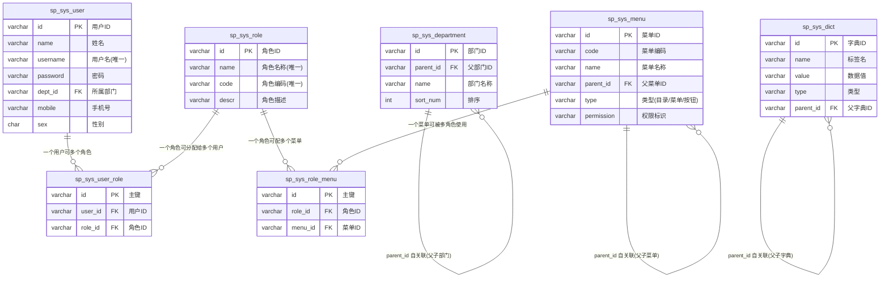
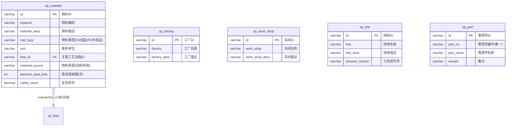
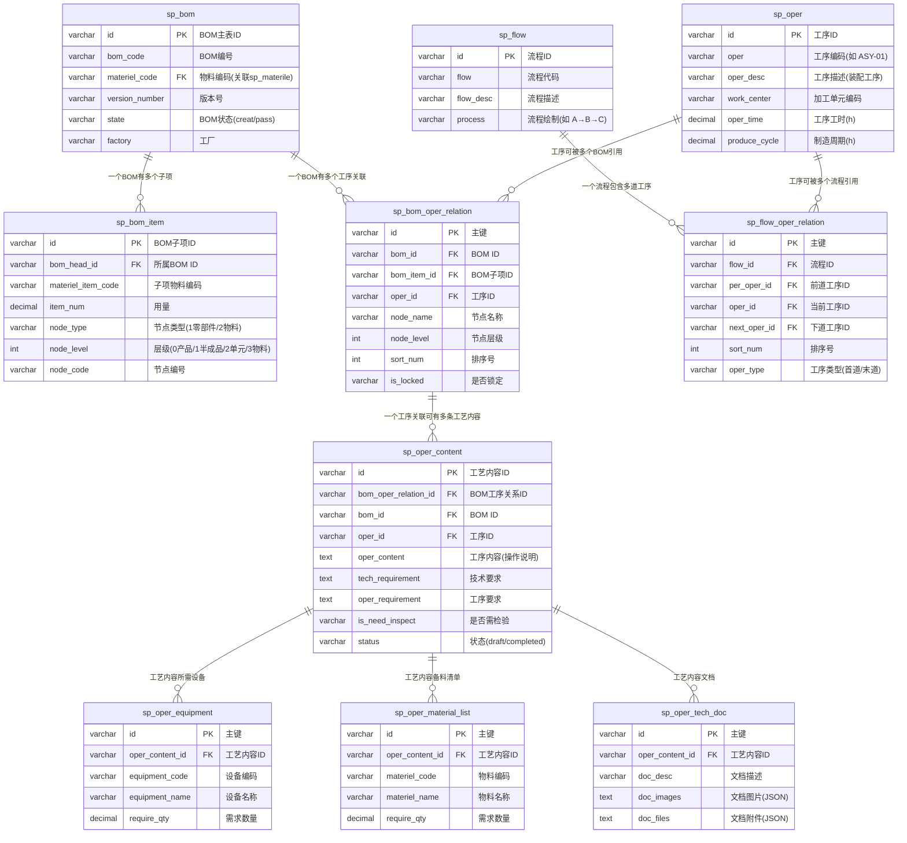
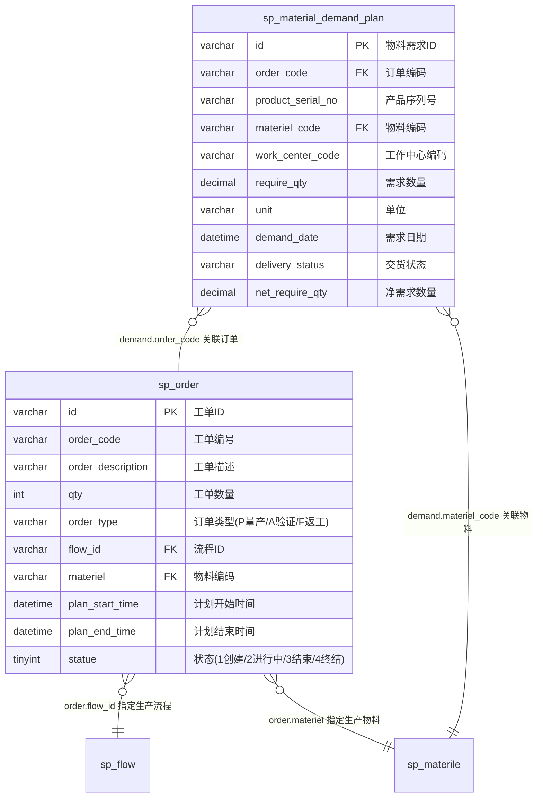
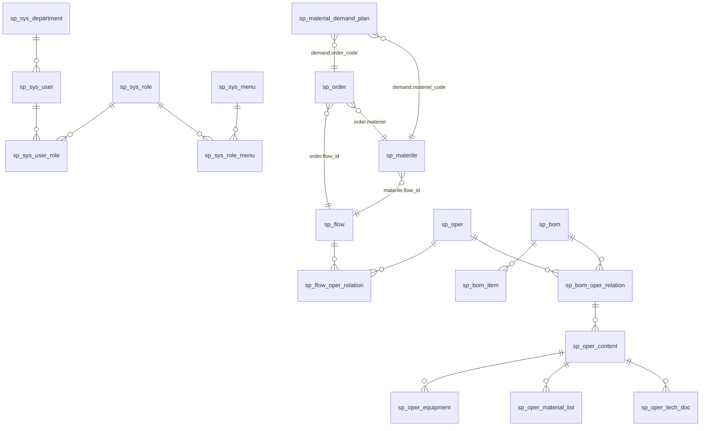

# MES 制造执行系统 - 数据库 ER 图

## 一、系统管理模块（用户 / 角色 / 权限）

## 二、基础数据模块（物料 / 工厂 / 线体）

## 三、技术管理核心模块（BOM / 工艺路线 / 工序）— 最复杂

## 四、订单与计划模块（从物料到生产）

## 五、完整全景 ER 图

---

## 关系图符号说明

| 符号 | 含义 |
|------|------|
| `||--o{` | 一对多（左边1个，右边多个） |
| `}o--||` | 多对一（右边1个，左边多个） |
| 主键 `PK` | 表里用来唯一标识一条记录的字段 |
| 外键 `FK` | 指向另一张表主键的字段，用于建立表之间的关联 |
